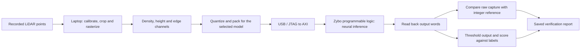
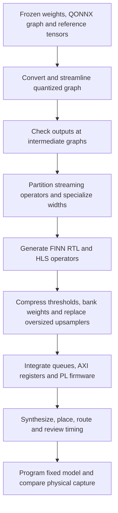

# LiDAR vehicle segmentation on a Zynq FPGA

This project follows a LiDAR frame from point-cloud preprocessing to a vehicle mask captured from a physical Digilent Zybo XC7Z010. It started with point-cloud denoising, progressed to low-precision neural networks for bird’s-eye-view (BEV) segmentation, and produced three hardware designs: a compact dual-model KITTI implementation, individually deployed nuScenes models, and a shared compute engine that can change precision between frames.

**Physical result.** The fixed nuScenes INT4 and INT8 designs each processed an unlabeled reference and three real frames on the Zybo. All eight captures matched their respective software references byte for byte across all 65,536 output cells per frame. On the first labeled frame, INT4 achieved 0.4262 IoU and INT8 achieved 0.3911. The other frames illustrate why numerical agreement and detection quality need separate measurements.

**Latest engineering result.** A single 16-lane engine implements both larger nuScenes networks. It routed at 35 MHz and reproduced all eight reference outputs in full-frame RTL simulation. Its physical switching test and the frozen-KITTI cross-dataset board test are prepared for user-operated execution.

**Tools and methods:** Python, NumPy, quantization-aware training, QONNX, FINN, HLS, SystemVerilog, Verilator, Vivado, Tcl, JTAG-to-AXI and dual RV32I soft processors.

## How a frame reaches the board



The host prepares and transfers a recorded frame. The programmable logic computes the neural output. On the RISC-V builds, the control firmware also runs inside programmable logic. The laptop reconstructs the image, runs the independent checks and displays results. This setup measures correctness with a replayable input. End-to-end JTAG time includes host and transport overhead.

## 1. From point sensing to vehicle footprints

Early project records describe three experiments that informed the later design. A one-dimensional convolutional autoencoder reconstructed normalized planar LiDAR scans using mean-squared error. Rotation augmentation, shape classification and pointwise wall/corner labeling explored whether geometry survived denoising. A radar-to-LiDAR teacher–student experiment investigated coordinate alignment and used a two-metre temporal centroid gate to suppress transient detections. These are historical exploratory stages. The physical results below begin with the BEV pipeline.

BEV turns irregular returns into a fixed grid in vehicle coordinates. Each cell accumulates point density, height and a local edge feature. A convolutional model predicts vehicle occupancy per cell. This choice makes the tensor size, memory layout, spatial coverage and hardware/software comparison explicit.

## 2. Compact KITTI model and first FPGA implementation

The KITTI pipeline used a 128 × 128 grid covering 60 m forward and 30 m on either side. The original target represented vehicle footprints for Car, Van and Truck. The training record describes a frame-level split of 5,236 training, 1,122 validation and 1,123 test frames, with Adam and weighted binary cross-entropy plus Dice loss. Separate INT4 and INT8 networks contained 2,614 parameters each. Their saved operating thresholds were 0.7 and 0.4, respectively.

The selected release, `selected_001`, used a FINN native-RTL implementation. The manual image let the host select either network. The adaptive image added two programmable-logic RISC-V harts for control. Both contained the compact network pair. Saved routed reports at 50 MHz show the hardware cost of these two configurations.

| KITTI image | LUTs | Flip-flops | BRAM36 equivalents | DSPs | Setup slack |
|---|---:|---:|---:|---:|---:|
| Manual | 9,219 | 13,664 | 55.5 | 46 | +7.910 ns |
| Adaptive | 12,834 | 15,243 | 57.5 | 46 | +0.655 ns |

The historical integer decision check found zero changed **valid mask cells** over 1,123 held-out frames per precision. Three archived real-frame board masks independently matched their references. An archived adaptive empty-frame capture differed by 83 bits across 36 words despite a passing scalar log. Its provenance remains unresolved. This discrepancy motivated keeping raw captures alongside summary metrics.

## 3. Moving to nuScenes

Two nuScenes branches answered different questions.

| Branch | Input and network | Training or selection outcome |
|---|---|---|
| Local footprint experiments | 128 × 128, 9,830-parameter final compact model | An early INT8 baseline reached about 0.183 validation IoU. A context-enhanced trial reached 0.247849. Subsequent teacher–student and quantization-aware experiments recorded held-out IoU of 0.289105 for INT8 and 0.268498 for INT4. |
| Team-supplied StreamBEVNetQ, deployed on Zybo | 256 × 256, 86,284 parameters, 11 convolutions, two pooling stages and two nearest-neighbour upsampling stages | Existing trained INT4 and INT8 weights and QONNX exports were frozen for compilation. The package records 8,095 training, 1,034 validation and 991 test frames. |

The deployed branch predicts **LiDAR-hit vehicle regions**. The preprocessing rotates sensor points into ego-aligned axes, retains a sensor-centred origin, removes ego returns and crops to 51.2 m forward and ±25.6 m laterally. Each 0.2 m cell stores clipped point count divided by eight, normalized maximum height and a Sobel edge magnitude normalized using the 99.5th percentile. Car and truck returns inside annotated boxes form the core. A two-cell dilation forms a halo. The encoded labels are background 0, halo 1 and core 2.

The original KITTI footprint task and nuScenes hit-region task have different targets. Their native IoUs describe their respective experiments. A separate aligned protocol below addresses transfer across datasets.

## 4. Numerical contract and compiler engineering

For the deployed nuScenes models, INT4 and INT8 identify hidden precision. Both receive signed-byte inputs. The host computes `clip(round_to_even(x × 128), −128, 127)`, converts channel-first tensors to pixel-interleaved NHWC order, and packs four successive bytes per little-endian word. One frame contains **196,608 input bytes** and **65,536 signed output bytes**. The output scale is 0.125. The frozen decisions mark output codes ≥ 4 positive for INT4 and ≥ 1 for INT8.



- Saved-reference checks recorded zero output difference through conversion and streamlining for both networks. Intermediate graphs helped isolate conversion errors from later integration failures.
- Uniform, power-of-two-spaced thresholds allowed exact subtraction, shifting and saturation. The irregular final INT4 head retained its table. Arithmetic checks covered 427,192 selected values; 21 layer-specific stream tests exercised thresholds, resets and stalls.
- The implementation combined FINN RTL with HLS-generated operators. Repairs addressed generated stream port names, HLS version compatibility, width conversion and IP packaging. Bounded upsampling and banked weight storage reduced memory pressure.
- The larger nuScenes networks exceeded the device budget when instantiated together in the first design. Separate 50 MHz images made it possible to validate each full network physically before designing the shared engine.
- Each fixed image included two RV32I harts, firmware, software interrupts, telemetry and JTAG-readable registers. The controller reported a precision recommendation while the programmed model stayed fixed. A saved INT4 reference run reported both harts booted, three interrupts at capture time and last interrupt latency of 21 cycles.

## 5. Physical nuScenes verification and live demonstration

The runner interleaves input writes and output reads through bounded queues. Reusing JTAG transaction objects reduced a measured register-read operation from about 75 ms to 44 ms in a 20-read microbenchmark. The live viewer uses transferred words and captured bytes to reveal completed rows. It shows the density channel, output mask and label overlay; green marks true positives, red false positives and blue false negatives. A separate replay mode supports rehearsal.

Each physical capture was checked against the matching software byte stream. A second comparison scores the thresholded mask against labels. Strict IoU is TP / (TP + FP + FN), using label > 0. IoU_d2 applies an additional 5 × 5 square dilation to that target before calculating overlap. All counts below are **BEV cells**.

| Real frame | Precision | TP | FP | FN | Strict IoU | IoU_d2 | F1 |
|---|---|---:|---:|---:|---:|---:|---:|
| 01 · scene 0002 | INT4 | 883 | 1,129 | 60 | 0.426158 | 0.340954 | 0.597631 |
| 01 · scene 0002 | INT8 | 876 | 1,297 | 67 | 0.391071 | 0.337198 | 0.562259 |
| 02 · scene 0042 | INT4 | 0 | 351 | 0 | 0 | 0 | 0 |
| 02 · scene 0042 | INT8 | 0 | 501 | 0 | 0 | 0 | 0 |
| 03 · scene 0043 | INT4 | 61 | 436 | 0 | 0.122736 | 0.166096 | 0.218638 |
| 03 · scene 0043 | INT8 | 61 | 395 | 0 | 0.133772 | 0.216730 | 0.235977 |

Frame 01 favors INT4 on both missed and false-positive cells. Frame 02 contains zero labeled positives and both models produce false positives. On frame 03 both recover all 61 positives, while INT8 produces 41 fewer false-positive cells. The additional reference fixture has no labels and therefore contributes only to byte verification. Across the four inputs and two precisions, all **524,288 captured output bytes** matched. These three labeled frames establish case-level behavior; dataset-level accuracy requires the held-out evaluation.

## 6. Frozen-model portability across LiDAR datasets

Can the same trained model process a different sensor’s data after adapting the input? This experiment freezes the KITTI weights, decision rules and manual dual-network bitstream. A nuScenes adapter decodes the five-float point records, rotates points by the recorded calibration and applies the original KITTI rasterizer, normalization, precision-specific quantization and packing. Both datasets then enter the same 128 × 128 hardware interface: 16,384 pixel words in and 512 binary mask words out.

The aligned evaluation uses Car/Truck footprints within a front-view visibility proxy. KITTI Van and DontCare regions are excluded. Annotation conventions and the ground-plane visibility approximation still affect interpretation.

| Software engineering pilot | Frames | INT4 micro IoU | INT8 micro IoU |
|---|---:|---:|---:|
| KITTI controls | 3 | 0.193878 | 0.194444 |
| nuScenes examples | 3 | 0.173285 | 0.141079 |

Micro IoU sums TP, FP and FN across the three frames before division. Four original fixture checks reproduced the packed input words. Twelve case/precision checks verified model identity and packing. The full comparison has pinned cohorts of 1,123 KITTI frames and 991 nuScenes frames across 25 scenes. Its accuracy drop and the twelve physical pilot captures remain open. KITTI uses the original frame-level split, so sequence independence remains unestablished. [Portability audit](BHAIYA_REQUIREMENTS_AUDIT.md)

## 7. Shared INT4/INT8 engine for the larger nuScenes models

The shared engine reuses the previously trained weights. It computes eleven convolutions on one 16-lane datapath, with pooling, upsampling, two activation buffers and a reloadable weight bank. A 52 × 52 input tile yields a 16 × 16 output region. Tile scheduling preserves receptive fields, pooling phase and boundary padding. The engine buffers a stripe and exposes it for readback.


The firmware selects INT4 below score 32 and INT8 at or above 64. Intermediate scores retain the previous selection. A frame keeps its committed precision until completion. This is host-assisted switching between frames using one FPGA image. Both precisions follow the same lane schedule. The accuracy benefit of the selection policy remains to be evaluated.

| Shared-engine check | Recorded outcome |
|---|---|
| Full-frame RTL simulation | 8 outputs matched exactly, 128 stripe checks and 4 mode-transition tests |
| Host protocol | 10 mocked runs, including directed selection and density-driven selection |
| Routed target | XC7Z010CLG400-1 at 35 MHz, setup slack +4.192 ns, hold slack +0.015 ns |
| Resources | 9,357 LUTs, 51.5 BRAM tiles, 0 DSPs |
| Compute schedule | 523,450,824 tile-compute cycles per frame in RTL, approximately 14.96 s at 35 MHz |
| Physical validation | 10-run Zybo sweep prepared; physical captures pending |

The RTL cycle figure covers the compute schedule. Historical viewer times also include JTAG transfer and host work. Neither measurement establishes automotive real-time throughput. [Architecture](nuscenes_dynamic/ARCHITECTURE.md) · [Release acceptance and checksums](nuscenes_dynamic/release/acceptance.json)

## Reproduce the checks

Start from the extracted sweep kit or this project root with both suite directories present. The supplied Windows launcher uses Vivado 2023.2 and a configured Python executable. On another workstation, update the two executable paths at the top of the launcher. Raw dataset evaluation additionally requires the datasets and their metadata at the configured locations.

**Offline checks** validate the prepared inputs and release artifacts without opening JTAG.

```powershell
.\RUN_ZYBO_SWEEPS.ps1 -Suite Both
```

**Physical checks** are user-initiated. With the legacy Zybo connected and its JTAG target released by other sessions, the following command programs the board and runs both suites.

```powershell
.\RUN_ZYBO_SWEEPS.ps1 -Suite Both -ProgramZybo
```

A successful future run should emit `PORTABILITY_SWEEP_PASS captures=12` and `DYNAMIC_SWEEP_PASS captures=10`, followed by the combined summary path. Preserve the timestamped run logs, raw captures, mode observations, checker outputs and hashes. The [Zybo run guide](ZYBO_RUN_GUIDE.md) includes the Vivado Tcl alternative and per-suite instructions.

## Explore the implementation

| Entry point | What to inspect |
|---|---|
| [Engineering history](overview_content.md) | Dated record of the earlier KITTI work, local training, compiler decisions and fixed nuScenes board preparation |
| [Historical FINN manual](historical_finn_manual_20261020/FINN_AND_ZYBO_MANUAL.md) | Original model conversion workflow and numerical gates |
| [Frozen KITTI portability study](portability_study/) | Dataset adapter, frozen release, case manifests, independent checker and pilot reports |
| [Shared engine RTL](nuscenes_dynamic/rtl/) | Tile compute, memory, register interface, frame control and RISC-V integration |
| [Full-frame simulation](nuscenes_dynamic/sim/) | AXI simulation and host protocol tests |
| [Routed release](nuscenes_dynamic/release/) | Bitstream, debug probes and checksum-pinned acceptance record |
| [Sweep launcher](RUN_ZYBO_SWEEPS.ps1) | Offline preflight and explicit hardware entry points |

The project demonstrates a reproducible path from quantized model to physical capture on a resource-constrained FPGA. Current research questions are how much accuracy a frozen model retains across sensors under aligned evaluation, and whether frame-level precision selection improves the accuracy–cost trade-off. The prepared experiments keep these questions independently testable.
